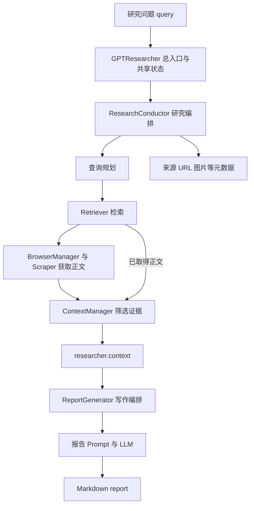

# GPT Researcher Agent 架构 数据流与学习总结

本文覆盖 `LEARNING_GUIDE.zh-CN.md` 阶段 1～6：单 Agent、研究与写作、配置和可替换组件、递归深度研究、LangGraph 多 Agent、Deep Agents。以 2026 年 10 月 8 日当前工作区源码为准，不展开前后端实现。文中的示例数据用于说明数据形态，不代表实际检索结果。

读完这些代码后，应该建立的核心认识是：**GPT Researcher 把开放式研究任务拆成若干受程序控制的步骤，让模型负责语义判断，让代码负责执行、状态传递和部分边界约束。研究阶段产出证据上下文，写作阶段消费证据上下文；更复杂的模式在这条基础流水线外增加递归、章节分工或审阅。**

## 1. 从整体看项目中的 Agent

### 1.1 四种运行形态

| 形态 | 主要入口 | 谁控制下一步 | 核心产物 |
| --- | --- | --- | --- |
| 普通单 Agent | `GPTResearcher` | Python 方法和条件分支 | 研究 context，再生成 Markdown report |
| 递归深度研究 | `DeepResearchSkill` | Python 递归；模型生成查询和追问 | 多层证据、洞见及引用，再生成 report |
| LangGraph 多 Agent | `ChiefEditorAgent` | 显式节点、边和条件路由 | 各章节草稿、审阅状态、组装后的 report |
| Deep Agents | `build_agent()` | 框架工具机制及主编模型的工具调用决策 | 章节文件及最终 `report.md` |

这四种形态复用了许多研究能力，但控制方式不同。不要把 `DeepResearchSkill`、`multi_agents` 和 `deep_agents` 理解成同一套逻辑换了三个名字。

## 四个模式的初搜差别

四种 Agent 形态都复用了“研究”能力，但它们的初搜、拆分对象和并发方式不同。

| 模式 | 初始步骤 | 拆分成什么 | 后续执行 |
| --- | --- | --- | --- |
| 普通单 Agent | Retriever 搜索原问题 | 多个搜索子查询 | 子查询通过 `asyncio.gather()` 并发检索、抓取、筛选 |
| 递归深度研究 | 各 Retriever 初搜，生成研究方向 | 多个 `{query, researchGoal}` 研究分支 | 同层分支并发；每个分支内部运行一次完整普通研究 |
| LangGraph 多 Agent | 先完成一次普通研究并写出初始报告 | 多个报告章节 | 每个章节并发运行普通研究并生成章节草稿 |
| Deep Agents | `quick_search()` 获取搜索摘要 | 多个报告章节任务 | 主编委派 researcher；每个 researcher 调用普通研究工具 |

### 1. 普通单 Agent

你描述的流程最接近普通单 Agent 的 Web 路径：

```text
原始问题
  ↓
第一个 Retriever 初搜
  ↓
获得 URL + 搜索摘要
  ↓
战略 LLM 根据原问题和初搜结果生成多个子查询
  ↓
追加原始问题
  ↓
多个子查询异步并发执行
  ↓
Retriever 搜索 URL
  ↓
Scraper 抓取网页正文
  ↓
按子查询筛选正文
  ↓
合并 context
```

对应 [researcher.py](/Users/ernurat/Desktop/agent学习/gpt_research/gpt_researcher/skills/researcher.py:303)。

这里有两点需要修正：

第一，初搜通常得到的是 URL 和摘要，并不一定是“部分正文”。例如 Tavily 的结果类似：

```python
{
    "href": "https://example.com/article",
    "body": "搜索结果摘要"
}
```

系统随后会抓取这些 URL 的真实正文，并将初搜来源形成的 context 一起保留下来。

第二，后续不是“多个子问题并行进行普通 research”。它们并不会各自创建新的 `GPTResearcher`：

```python
await asyncio.gather(
    self._process_sub_query(sub_query, ...)
    for sub_query in sub_queries
)
```

每个子查询只是执行：

```text
搜索 → 抓取 → 上下文筛选
```

所有子查询仍属于同一个 `GPTResearcher` 对象，并共享：

```text
visited_urls
research_sources
context_manager
scraper_manager
costs
```

另外应称为“异步并发”，不是“同步并行”。它们在同一个异步流程中并发等待网络任务，不一定运行在不同 CPU 核上。

### 2. 递归深度研究

深度研究才真正会为每个外层分支创建新的普通 `GPTResearcher`：

```text
原始问题
  ↓
初搜
  ↓
战略 LLM 生成研究方向问题
  ↓
战略 LLM 生成 breadth 个 query + researchGoal
  ↓
同层并发
  ├─ 新 GPTResearcher → 完整普通研究
  ├─ 新 GPTResearcher → 完整普通研究
  └─ 新 GPTResearcher → 完整普通研究
  ↓
战略 LLM 从每个分支提取
learnings + citations + followUpQuestions
  ↓
构造下一层问题并递归
```

对应 [deep_research.py](/Users/ernurat/Desktop/agent学习/gpt_research/gpt_researcher/skills/deep_research.py)。

这里存在两层拆分：

```text
深度研究外层：
原问题 → 多个研究分支

每个研究分支内部：
分支 query → 普通研究的多个搜索子查询
```

因此一个深度研究节点不是一次简单搜索，而是一次完整的普通研究。

并发范围是：

```text
同一层的研究分支并发
兄弟分支的下一层子树依次递归
```

整棵树并不会一次性完全并发展开。

### 3. LangGraph 多 Agent

LangGraph 多 Agent 的初始步骤更重：

```text
browser 节点
  ↓
创建 GPTResearcher
  ↓
conduct_research()
  ↓
write_report()
  ↓
得到 initial_research 初始报告
```

这里名为 `browser` 的节点并不是只搜索几条摘要，而是完成一次普通研究并生成报告。

然后 Planner 根据初始报告拆分的是报告章节：

```text
initial_research
  ↓
LLM 规划 title + sections
  ↓
多个章节并发执行
  ├─ 章节 A：普通研究 → 章节草稿 → 审阅/修改
  ├─ 章节 B：普通研究 → 章节草稿 → 审阅/修改
  └─ 章节 C：普通研究 → 章节草稿 → 审阅/修改
```

对应：

- 主流程：[orchestrator.py](/Users/ernurat/Desktop/agent学习/gpt_research/multi_agents/agents/orchestrator.py)
- 章节并发：[editor.py](/Users/ernurat/Desktop/agent学习/gpt_research/multi_agents/agents/editor.py)
- 普通研究复用：[researcher.py](/Users/ernurat/Desktop/agent学习/gpt_research/multi_agents/agents/researcher.py)

因此它拆分的主要对象是“报告章节”，每个章节内部才会再次进入普通研究的“搜索子查询”拆分。

结构上是：

```text
报告问题
  ↓
章节级拆分
  ↓
每个章节内部再做查询级拆分
```

### 4. Deep Agents

Deep Agents 的初始步骤是：

```text
主编调用 quick_search
  ↓
获得 URL + 搜索摘要
  ↓
主编模型规划章节和待办
  ↓
通过 task 工具委派章节
  ↓
每个 researcher 调用 deep_research 工具
```

这里的 `quick_search()` 默认只调用 Retriever，返回搜索结果摘要，不抓取网页全文，也不执行普通研究的子查询规划。

之后的章节拆分由主编 Agent 根据 Prompt 和工具机制完成，而不是固定的 `plan_research_outline()`。

每个章节调用的 `deep_research` 工具虽然名字里有 deep，但它实际创建的是：

```python
GPTResearcher(
    report_type="subtopic_report"
)
```

然后执行：

```python
await researcher.conduct_research()
await researcher.write_report()
```

因此它复用的是普通研究流程，不会进入 `DeepResearchSkill` 的递归研究树。

此外，“一次发出全部章节任务并行执行”主要是主编 Prompt 的要求。当前本地代码没有像 LangGraph 的 `asyncio.gather()` 那样直接提供一个硬编码的并发保证，需要观察 Deep Agents 框架和模型实际发出的工具调用。

### 可以用三层拆分理解整个项目

```text
第一层：报告级拆分
原始任务 → 多个报告章节
使用者：LangGraph 多 Agent、Deep Agents

第二层：研究级拆分
研究目标 → 多个研究分支，并继续递归
使用者：DeepResearchSkill

第三层：搜索级拆分
一个研究问题 → 多个搜索子查询
使用者：普通 GPTResearcher
```

普通单 Agent只有第三层。

递归深度研究是：

```text
第二层研究树
  ×
每个节点内部的第三层搜索子查询
```

LangGraph 多 Agent 和 Deep Agents 是：

```text
第一层章节拆分
  ×
每个章节内部的第三层搜索子查询
```

所以四种模式的共同点是最终都复用了 Retriever、抓取、上下文筛选和报告生成；它们并不都遵循完全相同的“初搜 → 拆成子问题 → 并发普通 research”流程。

### 1.2 单 Agent 的组件关系



`GPTResearcher` 持有任务状态和各协作对象。`ResearchConductor` 组织研究；`ReportGenerator` 组织写作；`ContextManager` 选择证据；`BrowserManager` 管理抓取。它们通过保存的 `researcher` 引用访问同一个对象。

因此，`ResearchConductor` 不是另一个独立研究 Agent，`skills/` 里的每个类也不是一位能自主对话的团队成员。这里主要是按职责拆分组件。

## 2. 首先认清流动的数据

### 2.1 六类关键数据

| 数据 | 典型形态 | 来源 | 后续用途 |
| --- | --- | --- | --- |
| `query` | `str` | 用户输入 | 角色选择、规划、研究、写作的共同目标 |
| 子查询 | `list[str]` | 规划模型 | 为不同研究角度检索资料 |
| 搜索结果 | `list[dict]`，常见 `href/body` | Retriever | 给规划提供概览，并提供待抓取 URL |
| 正文资料 | `list[dict]`，常见 `url/raw_content/title` | Scraper 或返回全文的 Retriever | 进入上下文选择；保存来源资料 |
| `context` | 普通 Web 成功路径主要是 `str` | 上下文筛选与合并 | 作为写作模型的证据输入 |
| `report` | Markdown `str` | 写作模型或多 Agent 组装 | 最终研究内容 |

其中最重要的转换是：

```text
研究意图 query
  → 可执行的搜索字符串
  → 外部来源地址与摘要
  → 来源正文
  → 与问题相关且带来源标记的证据
  → 有结构的报告
```

搜索摘要、来源正文、筛选后的证据和最终结论各有不同含义。排查问题时不能把它们统称为“搜索到的内容”。

### 2.2 证据旁边还有元数据

- `visited_urls`：用于 URL 去重，普通研究时通常是集合；深度研究结束后会被返回的 URL 列表替换。
- `research_sources`：抓取或研究过程中保存的来源记录；不是“报告实际引用的来源集合”。
- `research_images`：从抓取结果中选择的图片 URL。
- `available_images`：可选生成图片的元数据，供报告模型决定如何插入。
- `research_costs/step_costs`：经费用回调累计的金额及阶段统计。
- `agent/role`：角色名称和角色 Prompt，影响模型任务定位。

`context` 的实际类型并不完全统一：Web 路径常返回字符串，空结果可能是 `[]`，向量库路径可能返回字符串列表。因此，`len(context)` 可能表示字符数，也可能表示条目数；不能直接把日志中的 context length 当成 token 数。

## 3. 沿真实顺序追踪一次普通研究

以下用一个示例任务贯穿主链路：

> “分析企业采用 RAG 时，成本、效果和维护复杂度之间的权衡。”

### 3.1 初始化 先准备状态和组件

```python
researcher = GPTResearcher(query=query, report_type="research_report")
context = await researcher.conduct_research()
report = await researcher.write_report()
```

初始化期间主要做四件事：加载配置；保存任务参数与已有状态；把 Retriever 名称解析成类；创建研究、写作、上下文、抓取等协作对象。此时通常还没有执行完整搜索与报告生成。

`memory` 采用延迟初始化。只有选中的流程确实需要 embedding 时才构建相关对象。这使关键词筛选等路径不必先准备向量模型。

对象内部状态让两个公开方法能够衔接：`conduct_research()` 将资料保存到 `researcher.context`，`write_report()` 随后从这个字段读取。调用者不必把研究结果重新作为参数传回，但可以通过 `ext_context` 提供外部上下文。

注意 `ext_context or self.context` 使用真值判断。空字符串或空列表不会强制覆盖已有 context，而是回退到内部资料。

### 3.2 选择研究角色

`GPTResearcher.conduct_research()` 在没有完整的 `agent/role` 时调用 `choose_agent()`。模型返回 JSON，关键字段是 `server` 和 `agent_role_prompt`；代码解析出角色名称和角色说明。

这里的 `server` 是历史字段名，读取它并不意味着启动某台服务器或动态创建一种 Python Agent 类。实际执行仍由当前 `GPTResearcher` 的流水线负责，角色主要作为模型的指令背景。

如果研究是一个子主题，`parent_query` 会与本次 query 一起提供给角色选择，使角色知道大报告的背景。JSON 解析失败时会尝试修复、提取，最终回退到默认研究角色。

外层和 `ResearchConductor` 内部都有角色检查。正常情况下外层已经填好，内层不会再调用一次模型。

### 3.3 先看初步资料 再规划研究问题

普通 Web 研究中，`_get_initial_search_results()` 首先使用 `retrievers[0]` 搜索原问题。然后 `plan_research()` 把初始搜索结果交给 `plan_research_outline()`，再由 `generate_sub_queries()` 请求战略模型生成子查询。

这是一种有初步资料支撑的规划。模型可以根据已经出现的术语与议题细化方向，而不是只凭用户的一句话分解任务。但初始资料只来自第一个检索器，因此检索器顺序会影响规划输入。

示例子查询可能是：

```python
[
    "enterprise RAG retrieval quality evaluation",
    "RAG indexing inference cost tradeoffs",
    "RAG data update maintenance challenges",
]
```

模型响应先经 `json_repair` 解析，再转换成查询列表；空输出可以回退到原问题。战略模型调用还有参数重试及 smart 模型降级路径。

对于非 `subtopic_report`，执行层会额外追加原始 query，保证整体问题也被研究。**`MAX_ITERATIONS` 在这里主要通过 Prompt 控制生成子查询的数量，不是普通 Agent 的 ReAct 循环次数。**

初始搜索结果还有第二个用途：在执行各子查询前，代码沿正常抓取与筛选路径把这些来源变成 `initial_context`。这样后续搜索即使没有再次返回这些 URL，规划阶段看到的来源也有机会进入最终证据。初始摘要不会直接被当作网页全文。

### 3.4 多个子查询并发 每个子查询获取自己的资料

`_get_context_by_web_search()` 使用 `asyncio.gather()` 处理子查询。每个 `_process_sub_query()` 会获取资料，并针对这个子查询调用上下文选择，最后返回一段 context。

并发维度要分清：普通研究的各子查询并发；单个子查询中普通检索器在 `_search_relevant_source_urls()` 的循环中依次搜索；阻塞搜索通过 `asyncio.to_thread()` 执行；抓取还受 WorkerPool 控制。因此，“用了 gather”不等于所有层次的网络调用都同时执行。

搜索结果可能长这样：

```python
[
    {"href": "https://example.org/rag-cost", "body": "搜索摘要……"},
    {"href": "https://example.org/rag-quality", "body": "搜索摘要……"},
]
```

Retriever 负责外部数据源适配：它接受查询，返回项目可以继续处理的结果。各提供商的搜索能力不同，统一接口并不意味着它们返回完全相同的语义或质量。

### 3.5 判断是否还需要抓取正文

`requires_scraping` 决定两条路径：

| 声明 | 含义 | 后续行为 |
| --- | --- | --- |
| `True` | 返回的是链接与预览 | 将 URL 交给 Scraper |
| `False` | 检索器已获取正文 | 使用 `raw_content`，省去重复抓取；正文缺失则回退抓取 |
| 未声明 | 兼容旧检索器 | 按 `raw_content` 长度等旧规则推断 |

例如当前 TavilySearch 明确声明 `requires_scraping=True`。搜索摘要即使很长，也仍然需要取得来源正文。

已经取得的正文进入 `prefetched_content`，后来与抓取结果合并。它的含义是“这份正文已经获取”，不是“之后还要拿这个 URL 抓一次”。

### 3.6 URL 去重与正文抓取

`_get_new_urls()` 检查 URL 是否已在 `visited_urls` 中；新 URL 被立即加入集合，再交给 `BrowserManager.browse_urls()`。BrowserManager 调用 `scrape_urls()`，由 Scraper 选择具体抓取实现并取得正文。

正文结果示意：

```python
{
    "url": "https://example.org/rag-cost",
    "title": "RAG Cost Analysis",
    "raw_content": "正文第一段……正文第二段……",
    "image_urls": [],
}
```

抓取结果被保存到 `research_sources`，图片候选被筛选后保存到 `research_images`，正文继续进入 ContextManager。Scraper 还包含阻拦页、无效正文等识别与过滤，说明 HTTP 成功并不自动代表取得了有效研究材料。

`visited_urls` 在抓取前就被更新，因此它更接近“本任务已领取或处理过的 URL”，不是抓取成功凭证。这个做法有助于避免并发重复抓取，但失败 URL 后续也可能被跳过。

### 3.7 从正文中选择可用于写作的证据

`ContextManager.get_similar_content_by_query()` 把 query 和 pages 交给 `select_context()`。页面字典被转换为 LangChain `Document`，正文进入 `page_content`，来源 URL 和标题进入 metadata。

```text
page.raw_content → Document.page_content
page.url         → Document.metadata.source
page.title       → Document.metadata.title
```

筛选后，`pretty_print_docs()` 将 Document 格式化为带来源、标题和内容的字符串。这些来源标记使写作模型能够看到证据来自哪里。

当前策略如下：

| `CONTEXT_FILTER` | 实际处理 | 需要 embedding 吗 |
| --- | --- | --- |
| `auto` | 有 TypeSafe key 选 Jev，否则选 keyword | 默认关键词路径不需要 |
| `keyword` | 切块后用 BM25 排序，按相对阈值筛选 | 不需要 |
| `embeddings` | 向量相似度检索与过滤 | 需要 |
| `jev` | 调用外部相关性筛选服务 | 不走本地 embedding 初始化 |
| `none` | 跳过相关性筛选，格式化资料 | 不需要 |

少量资料会直接格式化，跳过进一步筛选；Jev 或 embedding 路径的相应失败会降级到关键词筛选。关键词筛选若完全没有词汇重合，还会回退保留开头的块。

**这里的“压缩”很多时候是挑选原文块，并非让 LLM 把所有页面重新总结一遍。** 相关性筛选也不等于事实验证：被选中的段落可能相关却不可靠。

`none` 也不意味着每份无限长文档都原封不动送入模型：公共 Document 转换还有 `MAX_CONTENT_CHARS` 字符截断。不同长度限制位于不同层，必须跟踪实际消费者。

### 3.8 汇总研究上下文

每个子查询返回字符串 context，执行层过滤空结果，将 `initial_context` 和子查询结果拼接为总 context，写入 `researcher.context`。

如果启用 `CURATE_SOURCES`，SourceCurator 还会让 smart 模型按相关性、可信度等标准筛选和整理资料。它返回的字典列表会归一化为字符串；失败时保留原资料。默认不开启。

来源整理是一次模型判断，没有在这里实现逐条主张与原文的独立核验。日志中“verified”之类的词，不能直接解释成完成了客观事实验证。

到这里 `conduct_research()` 完成，返回的是资料，不是最终报告。

## 4. 不同来源如何汇入同一研究链路

`ResearchConductor.conduct_research()` 是资料来源的总分发点。整体目标是将不同来源转成写作可消费的 context。

| 输入方式 | 主要路径 | 需要注意的行为 |
| --- | --- | --- |
| `source_urls` | 指定 URL → 抓取 → 按原 query 筛选 | 此分支优先于 `report_source`；可选择补充 Web 搜索 |
| `web` | 初搜 → 子查询 → 搜索/抓取 → 筛选 | 普通研究主线 |
| `local` | DocumentLoader → 文档资料 → 按子查询筛选 | 复用规划方法，仍可能进行初始 Web 搜索 |
| `hybrid` | 本地/在线文档与 Web 两路 context → 合并 | 两路并发；不是先建一个统一向量库再检索 |
| `langchain_documents` | 外部 Document → 项目资料格式 → 筛选 | 复用文档研究流程 |
| `langchain_vectorstore` | 规划子查询 → 外部向量库检索 | `vector_store_filter` 限定检索范围 |
| Azure 文档 | 加载远程文件 → DocumentLoader → 文档研究 | 资料加载入口不同 |

本地模式之所以可能联网，是因为当前实现复用了 `plan_research()`，规划会先初搜；文档列表为空时，子查询路径还可能回退 Web 抓取。不能只看 `report_source="local"` 就推断整个任务严格离线。

MCP 在这一范围内只需理解其数据边界：项目把它包装成一种 Retriever，但结果可以是工具返回的资料或模型整理的内容，不一定是待抓取网页。所以它有独立执行、缓存和格式化路径，再与 Web context 合并。

`mcp` 表示信息来源；`fast/deep/disabled` 表示 MCP 执行策略。`fast` 预先用原问题获取缓存，`deep` 在子查询路径逐次执行，`disabled` 跳过该策略路径。规划初搜和“仅 MCP 时不生成子查询”等逻辑另有调用入口，因此要评估真实调用次数，不能只数策略分支。

## 5. 证据如何变成最终报告

### 5.1 写作链路

```text
GPTResearcher.write_report()
  → ReportGenerator.write_report()
  → 选择 ext_context 或 researcher.context
  → 检查 context 是否为空
  → actions.report_generation.generate_report()
  → 根据 report_type 选择 Prompt
  → smart LLM
  → Markdown 字符串
```

写作阶段消费已经收集的资料，不自动重做搜索。修改 tone 或 Prompt 后，可以基于现有证据重新生成报告；这也让研究质量与写作质量能够分别排查。

空上下文保护在调用写作 LLM 前执行：如果 context 为空白，直接返回无法生成可靠有来源报告的固定说明。它比单纯在 Prompt 中要求“不要编造”更明确，但只能防住“完全没有资料仍开始写”的情况，不能判定资料真假或是否足够。

### 5.2 Prompt 是模型任务契约

`prompts.py` 提供角色选择、查询生成、普通报告、资源报告、提纲、子主题等模板。报告类型映射决定选哪个生成方法；Prompt 输入中包含研究目标、context、来源类型、字数要求、语言、语气和引用格式。

普通报告的模型消息主要是：system 提供角色，user 提供证据与写作要求。`subtopic_report` 还会获得主问题、已有标题和相关已写内容，以约束章节范围并减少重复。

要区分三个控制量：`report_type` 选择任务模板；`report_source` 选择研究来源及部分引用要求；`cfg.report_format` 在 Prompt 中表示 APA 等引用格式。构造器中的 `report_format="markdown"` 和配置中的引用格式不是同一个概念。

Prompt 中的语言、字数、引用、章节边界主要是模型要求。代码没有因为写了“必须”就自动拥有严格验证这些要求的能力。

当前调用还有一个边界值得注意：研究规划和部分写作调用没有一路显式传递实例选中的 `prompt_family`，下层可能使用默认 PromptFamily。理解配置时，应核对传参链，不能仅凭初始化字段就断言它影响了所有模型调用。

### 5.3 模型调用有统一适配层

`create_chat_completion()` 负责模型参数、provider 构造、重试、响应和费用回调，再由 `GenericLLMProvider` 对接具体厂商。

源码区分 strategic、smart、fast 三类配置，但它们是职责配置，不是三位独立 Agent，也不是保证各调用都严格按某一角色使用模型。当前普通规划主要用 strategic，角色选择和报告写作主要用 smart。

不同模型对 temperature、推理强度和输出限制的支持不同，统一调用层会做部分参数适配。失败重试也意味着一次逻辑调用可能对应多次 API 请求。

### 5.4 引用与 Markdown 后处理的真实边界

普通 `write_report()` 返回模型生成的文本。它不会自动调用 `add_references()` 或 `table_of_contents()` 完成全部后处理。

- 文内引用与普通报告参考文献主要由模型按 Prompt 生成。
- `add_references()` 是可单独调用的工具：排序 URL 并追加参考列表，不验证 URL 是否真的支持对应论断。
- `extract_headers()` 将标题转成树；stack 只保存当前祖先链。
- `extract_sections()` 抽取标题和已写内容，供章节结构分析等后续流程使用。
- `table_of_contents()` 根据标题树产生缩进目录。

因此，来源记录、模型引用和最终参考列表是三种独立的数据。增加来源数并不自动提高引用正确率，追加 References 也不会修复错配的正文引用。

## 6. 配置与替换能力应怎样理解

### 6.1 配置如何变成运行参数

```text
DEFAULT_CONFIG
  → 合并 JSON 配置
  → 环境变量覆盖同名项
  → 大写键转为 cfg 小写属性
  → 拆分 provider:model
  → 调用者读取并传给具体组件
```

例如 `STRATEGIC_LLM="openai:..."` 被拆成 provider 与 model；`RETRIEVER="tavily,exa"` 被解析成名称列表，再映射为 Retriever 类。检索器选择还允许 headers 覆盖，实例参数也有各自的优先级。

不存在一个覆盖一切参数的统一优先级：配置属性、构造器默认值、headers、方法参数分别在自己的入口处理。确认行为时应追踪“声明 → 属性 → 消费者 → 下层参数”。

### 6.2 哪些是程序上限 哪些是模型要求

| 参数或约束 | 当前主要作用 | 约束强度 |
| --- | --- | --- |
| `MAX_ITERATIONS` | 普通规划的子查询数量要求 | 主要是 Prompt 要求 |
| `MAX_SEARCH_RESULTS_PER_QUERY` | 传给检索器的结果数 | 依赖检索器实现及 API |
| `MAX_SCRAPER_WORKERS` | 抓取 WorkerPool | 程序控制 |
| `TOTAL_WORDS` | 报告长度要求 | Prompt 要求 |
| 模型 token limit | 单次模型输出限制 | 传给 provider，不是输入证据预算 |
| 深度研究 breadth | 生成分支数，解析后也截取 | 本层有代码限制 |
| 深度研究 depth | 递归层数 | 程序控制 |
| 审阅修订次数 | 控制多 Agent 循环 | 默认有代码上限 |

学习配置的价值，在于理解这些边界，不能把配置文件中的数字都当成已经严格执行的系统保证。

### 6.3 新检索器的最小接入边界

项目既有内置名称映射，也支持已安装包通过 `gpt_researcher.retrievers` entry point 注册。新增检索器最关键的工作是：匹配构造和 `search()` 调用接口；返回可识别的 URL/正文字段；声明是否需要抓取；处理空结果与外部 API 异常；让名称可以被配置校验与工厂发现。

`BaseRetriever` 提供可选契约，实际也依赖鸭子类型。无需为每个检索器重写研究、上下文选择和报告生成。

## 7. 递归深度研究 数据驱动的追问树

### 7.1 入口切换

当 `report_type` 为 `deep` 时，外层在普通角色选择和研究分发前转入 `DeepResearchSkill.run()`。它最终仍返回 context，最后报告继续通过 `write_report()` 生成。

```text
原问题
  → 初搜及研究方向问题
  → 自动填入继续研究的回答
  → 生成 query/researchGoal 列表
  → 每个分支执行普通研究
  → 提炼 learnings/citations/followUpQuestions
  → researchGoal + followUpQuestions 形成下一层问题
  → 递归与汇总
  → 裁剪后的总 context
  → smart LLM 写最终报告
```

初始研究问题没有真的等待用户逐题作答，代码自动使用 `Automatically proceeding with research` 继续。

### 7.2 每个节点内部还有一条完整普通研究链

每个分支创建 `GPTResearcher(report_type="research_report", report_source="web")`，调用 `conduct_research()` 收集资料，然后战略模型提炼结果。分支不会先写一份完整报告再总结它。

所以一次“深度节点研究”内部还有普通研究的子查询规划、检索、抓取与筛选。深度树节点数、搜索请求数、模型调用数是三个不同的量。

分支的输出形态是：

```python
{
    "learnings": ["洞见 A", "洞见 B"],
    "citations": {"洞见 A": "https://example.org/a"},
    "followUpQuestions": ["下一步需要回答的问题"],
    "researchGoal": "本分支的研究目标",
    "context": "这个普通研究器筛选后的资料",
    "sources": [...],
    "visited_urls": [...],
}
```

`learnings` 是提炼出的洞见，`citations` 是洞见文本到 URL 的映射，`context` 保留研究证据，`followUpQuestions` 推动下一层扩展。洞见并没有完全替代原资料。

历史 learnings/citations 会递归传递并累积，但下一层查询生成 Prompt 没有直接读取全部历史洞见；它主要接收由分支目标和追问组成的 `next_query`。不能把“状态中有历史洞见”解释成“模型每一层都看到了全部历史证据”。

### 7.3 breadth depth 和实际调度

模型足额返回且分支成功时，breadth=2、depth=2：

```text
原问题
├── Q1
│   ├── Q11
│   └── Q12
└── Q2
    ├── Q21
    └── Q22
```

共执行 6 次普通研究器的 `conduct_research()`。下一层 breadth 使用 `max(2, breadth // 2)`，因此 2 不会再缩小；初始 breadth=1 时，下一层反而可能变成 2。

实际调度先并发完成 Q1/Q2，再遍历结果，研究 Q1 的子树，然后研究 Q2 的子树。同层并发，兄弟子树的递归调用依次执行。

semaphore 在每次递归调用中创建，限制这一层同时执行的普通研究与提炼分支。它不是对所有内部搜索、抓取和 LLM 请求统一生效的全局并发限制。

### 7.4 深度研究裁剪并非语义压缩

`MAX_CONTEXT_WORDS=25000` 通过 `str.split()` 计算空白分词数，不是 tokenizer token 数，也不是中文字符数。

裁剪从列表尾部向前保留完整条目，遇到放不下的条目就停止；如果尾部单条已经超限，则保留该条前面的指定数量空白分词。递归汇总和最终汇总都会裁剪。

这一机制没有基于重要性评分决定保留哪些证据，也没有保证尾部一定最相关。最终列表先放 learnings、后放原研究 context，因此尾部优先保留还可能挤掉前面的洞见。对于缺少空格的中文，空白分词上限尤其不能代表真实 token 预算。

### 7.5 失败和费用边界

生成零个有效查询、或者该层分支全部抛错，会停止继续下降并保留已累计结果。但“分支没有正文”与“分支抛错”不同：成功返回空资料的分支仍可能继续提炼和递归。

最终写作仍有空 context 保护，但它不能识别所有不充分证据。费用方面，深度层若干战略模型调用没有传费用回调，子研究器费用也没有显式汇总给父对象。因此父研究器显示的 costs 不应作为整棵研究树的完整账单。

## 8. LangGraph 多 Agent 两层工作流

### 8.1 外层按整份报告组织任务


这里的 `browser` 节点其实执行初始完整研究和写作，得到 `initial_research` 报告；planner 以它为基础生成标题、日期和章节列表。它不是单纯打开网页的 BrowserManager。

外层状态的变化：

```text
task
  → initial_research
  → title/date/sections
  → human_feedback/plan_revision_count
  → research_data
  → introduction/conclusion/table_of_contents/sources/headers
  → fact_check_notes/fact_check_revision_count
  → diagrams
  → report
```

`ResearchState` 描述图中的数据字段；节点返回字典更新状态。当前这些字段没有定义自动追加的 reducer，不能因为它叫“共享状态”就认为所有列表都会自动合并。章节研究结果是在 Editor 中 gather 后显式收集。

### 8.2 每个章节还有研究 审阅 修订子图

```text
researcher 生成章节 draft
  → reviewer 按 guidelines 审阅
      ├── 接受 → 返回 draft
      └── 修改 → reviser → reviewer
```

Editor 为每个 section 调用子图，使用 `asyncio.gather()` 并发，最后取出每个子图的 draft，形成 `research_data`。draft 典型形态是 `{章节主题: 章节 Markdown}`。

章节 ResearchAgent 内部复用 `GPTResearcher(report_type="subtopic_report")`，先研究再写作。`sibling_sections` 会告诉每个章节哪些主题由其他分支负责，以减少重复；但并行分支不能看到其他分支最终写了什么，这仍然主要依赖 Prompt 来避免重叠。

Reviewer/Reviser 主要围绕草稿及要求进行文本审阅与修订，图中的回路不自动返回研究节点重新检索。

### 8.3 总 Writer 与 Publisher 的分工

各章节正文在进入总 Writer 前已经完成。Writer 根据 `research_data` 生成引言、结论、目录、来源列表及标题标签。Publisher 再确定性拼接这些部分与章节正文，产出最终 `report`。

这是一种“局部生成正文，整体生成首尾与结构，最后组装”的长报告策略。它降低了单次写完整报告的负担，但也把全局一致性、章节重复、引用去重等问题留给后续处理。

### 8.4 事实审阅与终止保证

FactChecker 接收引言、章节数据和结论，让模型判断是否有事实问题；当前没有通过这里重新抓取原来源或逐条验证引用。

发现问题后回到 Writer，而 Writer 的反馈 Prompt 主要要求修改引言和结论，外层图没有回到章节研究或章节修订子图。因此，若问题位于章节正文，这个外层循环不能保证正文被修正。

计划、章节草稿和事实审阅都有默认修订上限 3。收到第 4 次仍需修订的结果时，路由函数抛出超限异常，上层捕获后强制接受，继续运行。若上限设为 `None`，这些辅助路由不再强制封顶。

这里学习到的是明确的工程取舍：**终止约束可以保证流程继续，但强制接受不等于内容通过了质量检查。**

## 9. Deep Agents 主编委派与文件传递

### 9.1 实际组织方式

`deep_agents/agent.py` 用 `create_deep_agent()` 创建主编和 researcher 子 Agent。主编有 quick_search，研究员有 quick_search 和 deep_research；框架提供任务、计划和文件操作能力。

Prompt 要求的工作顺序是：

```text
主编 quick_search 获取概览
  → write_todos 规划章节与审校任务
  → task 委派各章节
  → 研究员 deep_research 得到章节材料
  → write_file 保存 sections/*.md
  → 主编 read_file 审校与修订
  → 组装 report.md
```

研究工具返回较长正文，研究员将正文落到文件，然后只向主编回传短摘要、来源数和路径。主编需要正文时读取文件。文件承担了团队协作中的大块材料存储，短消息承担交接说明。

`FilesystemBackend(root_dir=run_dir, virtual_mode=True)` 将这一文件工作区绑定到任务目录。

### 9.2 名字与实际行为要分开

工具 `deep_research()` 根据有没有 `parent_query` 使用 `subtopic_report` 或 `research_report`，执行普通 `conduct_research()` 和 `write_report()`，随后追加来源 URL。

**它没有设置 `report_type="deep"`，因此不会启用前面讲的 DeepResearchSkill 递归树。** 此处“deep”表示完整、较重的研究工具；项目内部递归深度研究则是另一个具体实现。

### 9.3 固定流程与模型决策的差异

LangGraph 外层把节点顺序、回路和路由写在 Python 中。Deep Agents 更多地通过主编 Prompt 规定委派与审校步骤，再由模型决定工具调用。

“所有章节任务在一个 turn 发出以并行”“每位研究员只调用一次 deep_research”“最终引用去重”等要求，在本地 `agent.py` 中主要体现为 Prompt 指令。不能仅凭这些指令就认定存在对应的硬性调用计数器或质量验证器。

这使它更接近灵活委派模式，也更需要通过实际轨迹确认模型是否遵守计划、是否重复调用、是否成功保存文件与组装报告。

## 10. 项目最值得学习的非常规之处

### 10.1 受控工作流中使用模型判断

普通研究主线主要由代码明确安排下一步，模型负责角色、查询、筛选整理和成文等语义工作。它没有一个贯穿全程、由模型每轮决定任意工具的通用 ReAct 主循环。深度研究和团队模式在外层增加新的控制结构。

学习价值是理解自主性的层次：任务可自动完成，不意味着所有步骤都由模型自由决策。

### 10.2 搜索既是规划输入 又是证据入口

初搜让规划接触现实资料；随后又取得初始来源正文作为证据。这条双用途路径使规划与检索相互衔接，但也意味着错误或偏斜的初搜可能影响后续研究范围。

### 10.3 RAG 不固定绑定向量库

网页研究可以用关键词筛选、外部评分、embedding 或直接保留资料。向量模型按需初始化。真正稳定的边界是“把来源转换成可供模型依据的证据”，具体算法可替换。

### 10.4 多 Agent 没有取代普通研究器

LangGraph 的章节节点和 Deep Agents 的重型工具，都继续复用 GPTResearcher。外层解决任务拆分、协作和审阅，内层解决证据收集与局部写作。这种组合减少了重复实现。

### 10.5 摘要与原证据共同保留

深度研究同时累积 learnings 和 context：洞见便于组织结论，原证据便于保留细节和来源。代价是资料体积增加、重复内容和裁剪优先级变得更复杂。

### 10.6 容错分散在多个边界

JSON 修复处理模型输出格式，Retriever 处理 API 异常，抓取过滤处理无效正文，上下文策略降级处理筛选能力不可用，空 context 保护阻止无资料成文，修订上限防止审阅无限循环。每一层解决的失败不同，不能用一个总 try/except 替代这些边界。

### 10.7 可执行约束与可信度保证不同

并发数、递归深度、空 context、循环次数可以由代码控制；事实正确、来源可信、引用支持论断、字数充足多依赖模型要求或额外评估。工程稳定性与研究可靠性需要分别判断。

## 11. 四种形态的对照总结

| 维度 | 普通单 Agent | 递归深度研究 | LangGraph 多 Agent | Deep Agents |
| --- | --- | --- | --- | --- |
| 拆分单位 | 搜索角度 | 研究问题树 | 报告章节 | 委派的章节任务 |
| 主要状态 | GPTResearcher 对象字段 | 递归结果与共享 URL | ResearchState 和 DraftState | 框架状态、待办与文件 |
| 扩展方式 | 一批子查询 | 分支目标与追问递归 | 每章独立研究与审阅 | 主编调用 task 委派 |
| 并发 | 子查询、抓取 | 本层受限并发，子树依次递归 | 多个章节子图 gather | Prompt 要求模型发出并行任务 |
| 主要审阅 | 可选来源整理 | 洞见提炼 | 草稿审阅和整稿文本事实审阅 | 主编读取文件并决定修订 |
| 成文位置 | ReportGenerator | 最终 ReportGenerator | 章节研究器加总 Writer | 研究工具加主编组装 |
| 终止机制 | 固定方法流程 | depth、空查询、失败分支 | 默认修订次数上限 | 取决于模型执行与框架运行约束 |
| 主要风险 | 查询覆盖、证据选择和引用 | 成本扩张、裁剪、摘要偏差 | 重复章节、回路修订范围有限 | 工具指令遵守、文件与组装质量 |

更复杂的编排提供了更多覆盖和修订机会，同时也增加模型调用、同步、状态管理与评估负担。不能单凭“Agent 更多”或“深度更大”判断结果更好。

## 12. 学完阶段 1～6 应形成的完整认识

### 12.1 你已经读过的能力如何连接起来

阶段 1 建立研究与写作的公开 API；阶段 2 跟踪外部信息进入系统；阶段 3 理解证据如何成为报告；阶段 4 理解组件和配置边界；阶段 5 在基础研究外增加追问树；阶段 6 在基础研究外增加章节协作、审阅和文件交接。

它们共同组成了一条可扩展研究架构：

```text
任务表示
  → 研究规划
  → 数据源适配与执行
  → 证据选择及来源保留
  → 局部或整体写作
  → 协作审阅与汇总
  → 输出研究报告
```

### 12.2 最重要的七项工程能力

1. **任务分解**：把抽象目标变成可执行的查询或章节，并判断分解是否覆盖问题。
2. **数据契约**：区分搜索结果、正文、Document、context、draft 和 report，保证字段与类型在边界转换。
3. **状态管理**：知道谁创建、谁读取、谁覆盖状态；区分对象共享、图状态、递归累积与文件传递。
4. **上下文管理**：选择证据、保留来源、控制长度，并理解筛选的误差和裁剪的损失。
5. **执行约束**：把并发、去重、递归、失败降级和循环终止落实在程序中。
6. **模型契约**：设计可解析的输出，区分 Prompt 要求、解析保证与语义验证。
7. **效果评估**：同时观察事实、引用、覆盖、延迟与费用，判断复杂编排是否带来实际收益。

### 12.3 如何确认自己已经真正理解

选一份报告，尝试从结果反向回答：

| 检查点 | 应能追溯到什么 |
| --- | --- |
| 一个核心论断 | 文内引用、写作 context、对应来源正文 |
| 一个搜索方向 | 子查询列表、规划输入与原问题 |
| 一个缺失观点 | 规划没覆盖、搜索没找到、抓取失败、筛选丢失或写作遗漏 |
| 一个重复章节 | 分工范围、 sibling_sections、草稿与总组装 |
| 一次高延迟 | 分支数、真实并发范围、外部请求、模型重试、审阅次数 |
| 一次费用异常 | 哪些调用有回调、子任务是否汇总、检索与其他 API 是否计入 |
| 一次审阅通过 | 正常接受还是超限强制接受；修订具体改变了什么 |

能够解释正常路径只是第一步。能够从错误产物找到数据在哪一层丢失、偏移或失去来源，才说明你建立了完整的架构理解。

### 12.4 对这个项目的评价

这个项目适合学习研究型 Agent 的工程组织：它把查询规划、数据源适配、抓取、上下文选择、报告生成和团队编排组合成可运行的研究过程，展示了模型能力如何被放进可维护的软件边界。

它也暴露了真实系统的局限：接口类型不完全一致，配置影响需要逐层追踪，来源与引用没有自动形成严格证据链，长上下文裁剪较粗，多 Agent 审阅的修改范围有限，跨分支费用并不总是完整汇总。

学习后应掌握的不是某个特定 Prompt 或模型名称，而是：**如何把一个不确定的研究任务变成有数据契约、有执行边界、有来源记录、可定位失败、可评估质量的 Agent 工作流。** 这些能力可以迁移到文献研究、企业知识分析、竞品调查和其他需要外部证据的任务。

## 附录 源码回查入口

以下入口对应本文的主要调用链；函数名用于定位，链接指向当前工作区文件。

| 内容 | 源码与关键符号 |
| --- | --- |
| 总入口与共享状态 | [agent.py](/Users/ernurat/Desktop/agent学习/gpt_research/gpt_researcher/agent.py)：`GPTResearcher.__init__ / conduct_research / write_report` |
| 研究分发与检索链 | [researcher.py](/Users/ernurat/Desktop/agent学习/gpt_research/gpt_researcher/skills/researcher.py)：`ResearchConductor` |
| 角色选择 | [agent_creator.py](/Users/ernurat/Desktop/agent学习/gpt_research/gpt_researcher/actions/agent_creator.py)：`choose_agent` |
| 查询规划 | [query_processing.py](/Users/ernurat/Desktop/agent学习/gpt_research/gpt_researcher/actions/query_processing.py)：`plan_research_outline / generate_sub_queries` |
| 检索器工厂 | [retriever.py](/Users/ernurat/Desktop/agent学习/gpt_research/gpt_researcher/actions/retriever.py)：`get_retrievers / get_retriever` |
| 检索器数据契约 | [base.py](/Users/ernurat/Desktop/agent学习/gpt_research/gpt_researcher/retrievers/base.py)：`requires_scraping` |
| 抓取管理 | [browser.py](/Users/ernurat/Desktop/agent学习/gpt_research/gpt_researcher/skills/browser.py)、[scraper.py](/Users/ernurat/Desktop/agent学习/gpt_research/gpt_researcher/scraper/scraper.py) |
| 上下文统一入口 | [context_manager.py](/Users/ernurat/Desktop/agent学习/gpt_research/gpt_researcher/skills/context_manager.py)、[select.py](/Users/ernurat/Desktop/agent学习/gpt_research/gpt_researcher/context/select.py) |
| 关键词筛选 | [lexical.py](/Users/ernurat/Desktop/agent学习/gpt_research/gpt_researcher/context/lexical.py)：`LexicalContextCompressor` |
| 来源整理 | [curator.py](/Users/ernurat/Desktop/agent学习/gpt_research/gpt_researcher/skills/curator.py)：`SourceCurator` |
| 报告生成 | [writer.py](/Users/ernurat/Desktop/agent学习/gpt_research/gpt_researcher/skills/writer.py)、[report_generation.py](/Users/ernurat/Desktop/agent学习/gpt_research/gpt_researcher/actions/report_generation.py) |
| Prompt 与标题引用处理 | [prompts.py](/Users/ernurat/Desktop/agent学习/gpt_research/gpt_researcher/prompts.py)、[markdown_processing.py](/Users/ernurat/Desktop/agent学习/gpt_research/gpt_researcher/actions/markdown_processing.py) |
| 配置与模型适配 | [config.py](/Users/ernurat/Desktop/agent学习/gpt_research/gpt_researcher/config/config.py)、[default.py](/Users/ernurat/Desktop/agent学习/gpt_research/gpt_researcher/config/variables/default.py)、[llm.py](/Users/ernurat/Desktop/agent学习/gpt_research/gpt_researcher/utils/llm.py) |
| 递归深度研究 | [deep_research.py](/Users/ernurat/Desktop/agent学习/gpt_research/gpt_researcher/skills/deep_research.py)：`deep_research / run / trim_context_to_word_limit` |
| 多 Agent 主图与状态 | [orchestrator.py](/Users/ernurat/Desktop/agent学习/gpt_research/multi_agents/agents/orchestrator.py)、[research.py](/Users/ernurat/Desktop/agent学习/gpt_research/multi_agents/memory/research.py) |
| 章节子图与研究 | [editor.py](/Users/ernurat/Desktop/agent学习/gpt_research/multi_agents/agents/editor.py)、[researcher.py](/Users/ernurat/Desktop/agent学习/gpt_research/multi_agents/agents/researcher.py) |
| 总写作 审阅与组装 | [writer.py](/Users/ernurat/Desktop/agent学习/gpt_research/multi_agents/agents/writer.py)、[fact_checker.py](/Users/ernurat/Desktop/agent学习/gpt_research/multi_agents/agents/fact_checker.py)、[publisher.py](/Users/ernurat/Desktop/agent学习/gpt_research/multi_agents/agents/publisher.py) |
| Deep Agents 委派与工具 | [agent.py](/Users/ernurat/Desktop/agent学习/gpt_research/deep_agents/agent.py)、[tools.py](/Users/ernurat/Desktop/agent学习/gpt_research/deep_agents/tools.py) |
